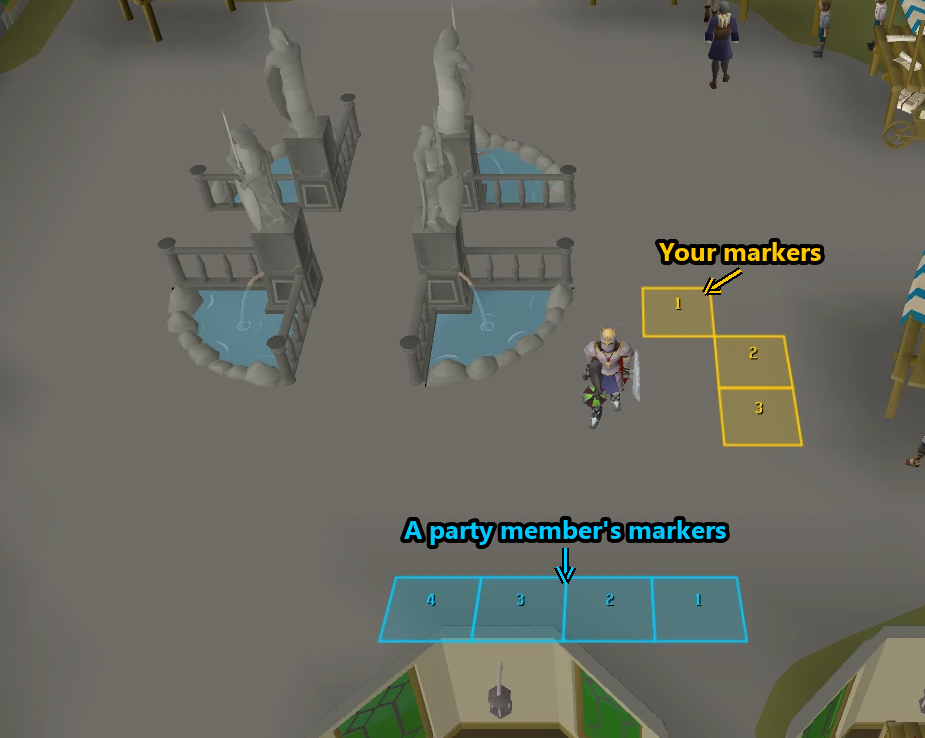
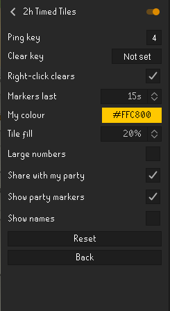

- Hold a key, click the ground, get a numbered tile marker. 
- Markers fade out on their own, and your party can see them.

<table width="100%">
<tr>
<td valign="top">

## What it does

- **Numbered markers.** Hold your Ping key and left-click the ground. A marker goes on that tile, numbered 1, 2, 3 in the order you click, and your character does not walk.
- **They disappear.** Each marker fades out after the time you set, 15 seconds by default.
- **Remove one.** Click a marked tile again and just that marker goes. The others keep their numbers.
- **Clear them all.** Hold the Ping key and right-click. A separate Clear key is optional.
- **Party.** In a RuneLite party, party members who also have 2h Timed Tiles see your markers, each player in their own colour (the plugin steers clear of matching colours). Names are optional. Members without it see nothing.

## Quick guide

1. **Pick your keys.** In RuneLite's settings, find 2h Timed Tiles and set "Ping key" (and "Clear key" if you want one). Pick a key RuneLite's Party ping does not use.
2. **Place.** Hold the Ping key and left-click the ground.
3. **Remove.** Hold the Ping key and click a marked tile again.
4. **Clear.** Hold the Ping key and right-click. You can also set a Clear key, or turn "Right-click clears" off in the settings.
5. **Party.** Make a party with RuneLite's Party plugin. "Share with my party" is on by default.

## Good to know

- **Always your click.** The plugin never places a marker by itself.
- **PvP.** Sharing pauses in the Wilderness and on PvP worlds. Your markers stay on your own screen.
- **Limits.** Up to 20 markers at once, each lasting 1 to 120 seconds.
- **Privacy.** Only the marker's tile, number, colour and duration are sent, to your own party through RuneLite's party server. Nothing else leaves your computer.
- **Something wrong?** Tell us in the 2hBuilds Discord.

</td>
<td width="28"></td>
<td align="right" valign="top" width="235">

 

</td>
</tr>
</table>

---

<strong>Found a bug or have an idea?</strong> Join the <a href="https://discord.gg/nsam4CfWzf">2hBuilds Discord</a>.

Want every setting explained? Read the <a href="https://github.com/2hBuilds/timed-tiles/blob/main/DETAILS.md">full details</a>.
